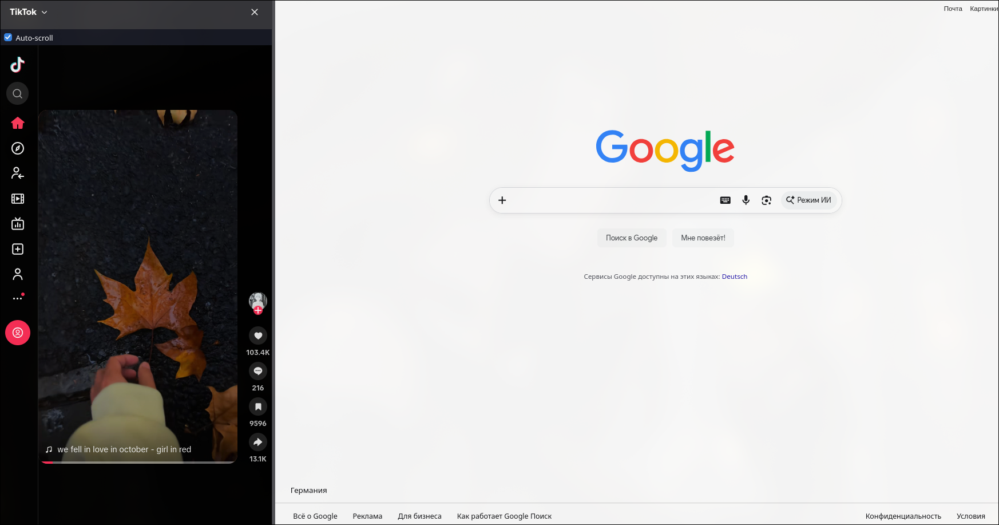
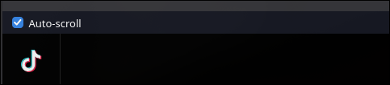

# TikTok Sidebar

A Firefox extension that shows the TikTok feed in the browser sidebar, so you can watch while you work in the main window.

> Unofficial project. Not affiliated with or endorsed by TikTok. "TikTok" and its logo are trademarks of their owner.

## Screenshots

| Sidebar | Auto-scroll toggle |
|---|---|
|  |  |

## Features

- TikTok "For You" feed in the Firefox sidebar (open and close with the toolbar button, `Ctrl+B` picker, or `View → Sidebar → TikTok`).
- **Auto-scroll**: a checkbox at the top of the sidebar moves to the next video when the current one ends. The choice is remembered.
- Hides the "continue in the TikTok app" prompts.
- Blocks TikTok's redirects to the App Store / Google Play (they can't be embedded) and reloads the feed instead of leaving a blank panel.
- Keeps you logged in: login cookies are made persistent for 30 days.

## Install

### Option A: signed `.xpi` (permanent)

Firefox only installs signed extensions permanently. Mozilla signs unlisted add-ons for free:

1. Create API keys at https://addons.mozilla.org/developers/addon/api/key/
2. Change `browser_specific_settings.gecko.id` in `manifest.json` to your own ID (an ID can belong to only one author), for example `tiktok-sidebar@yourname.dev`.
3. Install dependencies and put the keys in `.env`:
   ```sh
   npm install
   cp .env.example .env   # fill in WEB_EXT_API_KEY (JWT issuer) and WEB_EXT_API_SECRET (JWT secret)
   npm run sign
   ```
4. In Firefox press `Ctrl+O`, pick the `.xpi` from `web-ext-artifacts/`, and confirm.

### Option B: temporary (for development)

- `npm start` runs Firefox with a persistent profile in `.firefox-profile/`, so your login is kept between runs.
- Or open `about:debugging` → This Firefox → Load Temporary Add-on → pick `manifest.json`. The add-on is removed when Firefox closes.

## Usage

1. Click the TikTok toolbar button (pin it from the puzzle-piece menu if it's hidden).
2. Log in to TikTok in the sidebar once.
3. Tick **Auto-scroll** to advance automatically.

## How it works

| File | Role |
|---|---|
| `sidebar.html`, `sidebar.js`, `sidebar.css` | Sidebar panel: a sandboxed iframe with `tiktok.com` and the auto-scroll checkbox. |
| `background.js` | Removes `X-Frame-Options` and CSP `frame-ancestors` from TikTok frames, **only** when they are embedded by this sidebar. Persists login cookies, cancels app-store redirects, and toggles the sidebar from the toolbar button. |
| `autoscroll.js` | Content script (sidebar frame only). On video end it clicks TikTok's "next" button, falling back to scrolling the next item into view, then ArrowDown and wheel events. |
| `hide-app-banner.js` | Content script (sidebar frame only). Removes "open in app" overlays. |

### Permissions

- `webRequest`, `webRequestBlocking` and host access to `tiktok.com`, `tiktokv.com`, `apps.apple.com`, `itunes.apple.com`, `play.google.com`: header changes and blocking the app-store redirects.
- `storage`: remembers the auto-scroll setting.

The extension collects no data and sends nothing anywhere except to TikTok itself.

### Security notes

- TikTok's anti-framing headers are relaxed only for frames nested inside the extension's own sidebar. Other websites that embed TikTok keep TikTok's protection.
- Only login cookies are made persistent (30 days). Remove the extension to stop this.
- The iframe is sandboxed (no top-level navigation).

## Limitations

- TikTok changes its pages often. Auto-scroll and the banner remover rely on TikTok's page structure and may need updates.
- If login doesn't stick, log in once on tiktok.com in a normal tab. Firefox's cookie partitioning can affect third-party frames.
- Embedding TikTok this way and automating scrolling may go against TikTok's Terms of Service. Use at your own risk; a public Mozilla store listing is unlikely to be approved.

## Development

```sh
npm install
npm start       # run in Firefox with a persistent profile
npm run lint    # validate the manifest and code
npm run build   # build an unsigned .zip
npm run sign    # sign via AMO (needs .env)
```

## License

MIT, see [LICENSE](LICENSE).
